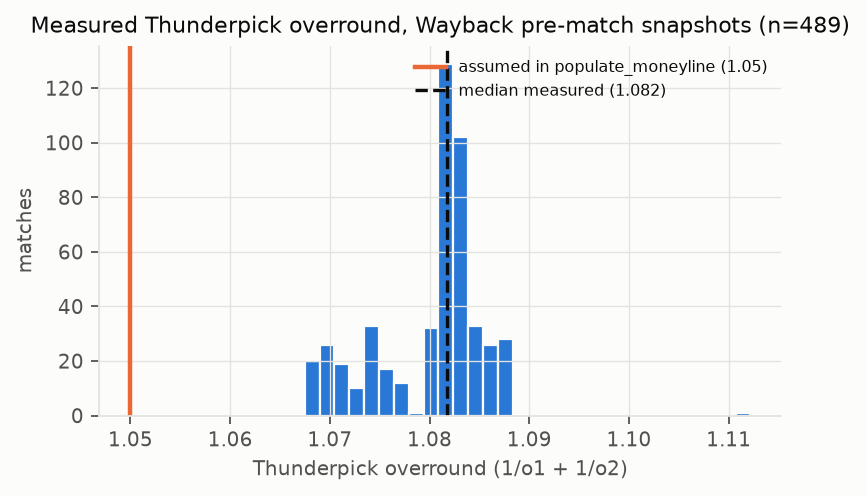
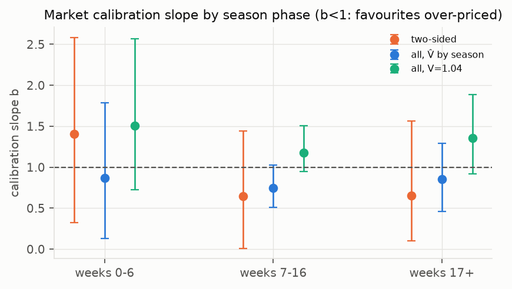
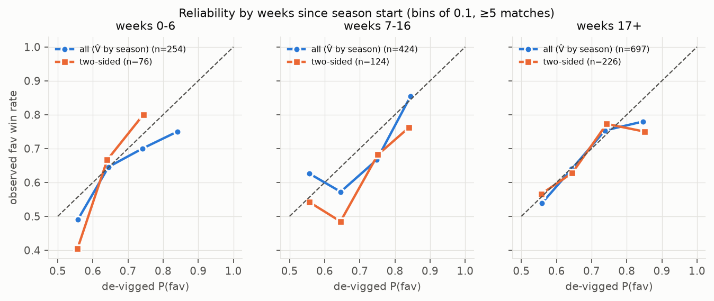
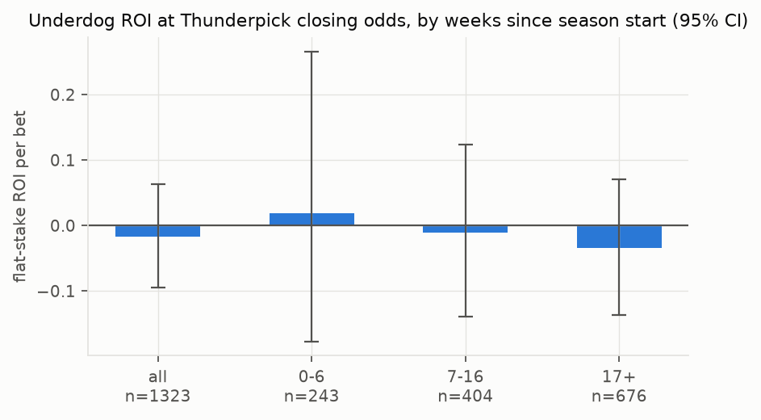
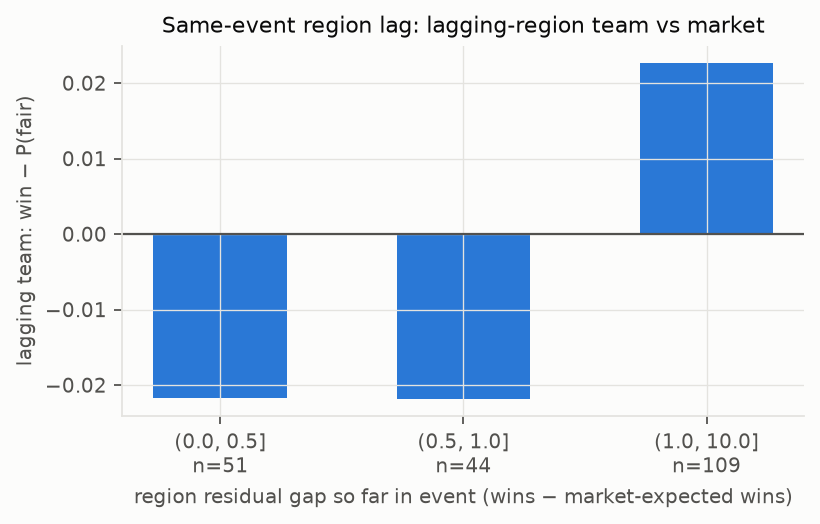
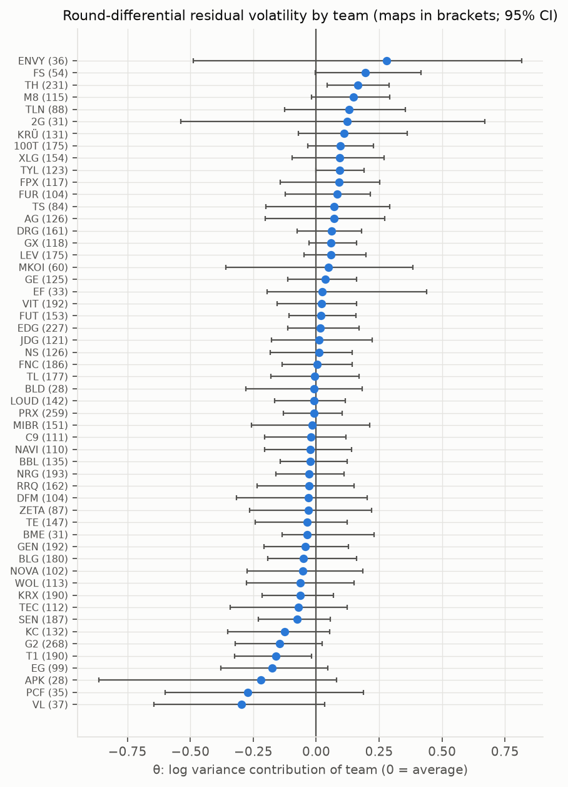
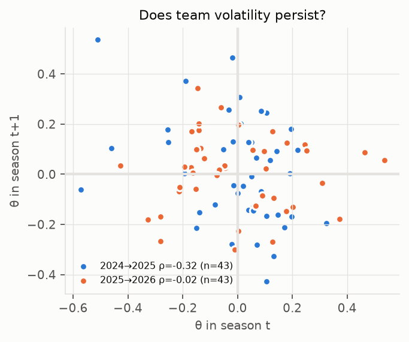

# Valorant market-structure research report

_Generated 2026-11-17 08:22 UTC by `research/make_report.py` from `research/out/*.json`. Every estimate: point [95% CI], CIs from 2,000 bootstrap resamples of **events** (clusters); n is stated beside each number. Nothing was tuned on test data — the only tuned quantities (half-life, shrinkage k, Benter weights) are fit on earlier seasons only._

## TL;DR

Headline caveat (§0.2): historical vlr pages publish only the winner's price, so analyses that need both prices use the 489 matches with archived two-sided pre-match snapshots, or are shown across overround bands. ROI at actual odds is exact on every row.

- **Roster churn** — no evidence that the market misprices roster churn early in the season.
- **Region lag** — no region-lag effect; the market updates on in-event regional results.
- **Round variance** — model one league-wide round dispersion; per-team variance parameters would fit noise.
- **Pricing model** — v2 is a large improvement over legacy but does not beat the Thunderpick close, and the Benter blend is not distinguishable from the market alone — the model is not yet a source of edge against the close.

## 0. Data

### 0.1 Build

| Item | n |
|---|---|
| tier-1 matches in DB (all seasons, finals only) | 1,951 |
| events | 57 |
| maps | 4,938 |
| rounds (map_rounds) | 104,737 |
| lineups (team-map starting fives) | 9,870 |
| canonical teams | 100 |
| team aliases | 2,085 |
| Thunderpick odds lines (published, winner side) | 1,594 |
| matches with two-sided Thunderpick pre-match snapshot | 489 |
| 2024–2026 matches used in tests (showmatches dropped) | 1,614 across 47 events |

Season split: 2024: 434, 2025: 530, 2026: 650. Market source: winner_only: 997, two_sided: 439, none: 178. Favourite ambiguous (winner price within 2/1.09–2/1.04, excluded from fav/dog tests): 46. Matches with churn defined for both teams: 1280.

Fixes landed in the production scraping path (commit on `research/market-structure`):

- **Team-name contamination**: `get_event_matches` split names out of the URL slug with a greedy regex, so team2 absorbed the event (`"Sentinels Champions Tour 2024 Amer…"`); names now come from the match-item DOM. Canonical id = vlr `/team/<id>`; `team_aliases` maps header names, sponsor base names (`VISA KRÜ (KRÜ Esports)` → KRÜ Esports), tags and the legacy slug names.
- **Book mixing**: `get_match_betting_odds` kept the minimum price across Thunderpick *and* Rainbet and labelled it Thunderpick; its ASCII-only regex dropped names like Gen.G/KRÜ. Now one book, by its logo class, both widget formats.
- **Imputed odds flagged**: `moneyline_matches.team{1,2}_odds_imputed`, `imputed_overround`.
- Per-match `region`, `tier`, `season`, `weeks_since_season_start` (from the season's first tier-1 match), `is_international`; `lineups` table (match, team, map, 5 vlr player ids).
- Scrape: tier-1 VCT 2024–26 + VCT 2023 (churn baseline) + EWC 2025/2026 main events (EWC 2024 had no VALORANT; EWC event pages also list tier-2 qualifiers, which were filtered out by date). 1951 match pages; **2,017 live vlr requests in total** (match pages + event/hub/search pages) against the ~2,000-page ceiling — 2023 came to 333 pages vs the ~250 estimated, and the run was hard-capped at 2,020. Every request ≥2.5 s apart and cached (`research/cache/request_ledger.csv`). Challengers was **not** scraped (not approved: 3,000+ pages). Wayback Machine: 873 logged archive.org requests plus the initial 40-match probe (CDX index + snapshots, ≥4 s apart; `research/cache/wayback_ledger.csv`).

### 0.2 The odds-observability problem

vlr.gg shows a completed match's odds widget only as *“$100 on X returned $Y at pre-match odds Z”* — **the winner's price only**. Every historical row in `moneyline_matches` therefore has the loser's price imputed (old code assumed a 5% overround). Excluding imputed rows, as the brief asked, excludes ~all of history, so (agreed with you mid-task):

1. **ROI at actual odds is exact** on winner-only rows: a winning bet's price is the observed one, a losing bet costs one unit whatever its price. ROI results are the primary evidence.
2. **Two-sided prices** were recovered from Wayback Machine pre-match snapshots of the same vlr pages for n = 489 matches (median 12.8 h before start). Calibration/Benter results are reported on this subset first.
   *Check:* where a snapshot and the published winner price both exist (n = 406), the snapshot price of the eventual winner is within a median 4.1% of its published price; 2 matches disagree by >50% *and* sit nearer the other side's price (likely a late line flip or a vlr data error). They are kept — dropping them would filter on the outcome.
3. On the full sample, de-vigged probabilities need an assumed overround V. Measured Thunderpick overround: median 1.0818 (p10 1.0707, p90 1.0856), vs the 1.05 the old code assumed. Full-sample regressions reconstruct winner-only rows with the **per-season measured median** (2023: 1.0821, 2024: 1.0819, 2025: 1.0824, 2026: 1.0712; Thunderpick cut its margin in 2026) and are bracketed with the agreed V = 1.04 / 1.06 / 1.08 bands — measured V never falls below 1.067, so the 1.04/1.06 rows are deliberately pessimistic about the assumption. Because the observed side is always the winner, an error in V shifts p_fair *toward or away from the realised outcome*, so slope estimates on winner-only rows are biased in a V-dependent way — read them as a band.



## 1. Roster-churn volatility

`churn_season` = share of a team's modal starting five (that match) not in its last lineup of the previous season; `churn_event` = vs its last lineup at its previous event; `churn_max` = max over the two teams. Offseason turnover is large (median team churn 0.4 = two players).

### 1.1 Calibration slope b in logit P(fav wins) = a + b·logit(p_fair)

b = 1: market calibrated; b < 1: favourites over-priced (prices too extreme); b > 1: too timid.

| Sample | n (events) | b overall | b weeks 0–6 | b weeks 7–16 | b weeks 17+ |
|---|---|---|---|---|---|
| two_sided | 439 (47) | 0.72 [0.34, 1.26] | 1.41 [0.32, 2.58] (n=79) | 0.64 [0.01, 1.44] (n=126) | 0.65 [0.10, 1.56] (n=234) |
| all_Vseason | 1390 (47) | 0.82 [0.58, 1.08] | 0.87 [0.13, 1.79] (n=256) | 0.75 [0.51, 1.03] (n=426) | 0.85 [0.46, 1.29] (n=708) |
| all_V1.040 | 1390 (47) | 1.31 [1.04, 1.61] | 1.51 [0.72, 2.57] (n=256) | 1.18 [0.95, 1.51] (n=426) | 1.36 [0.92, 1.89] (n=708) |
| all_V1.060 | 1390 (47) | 1.05 [0.80, 1.33] | 1.16 [0.43, 2.12] (n=256) | 0.96 [0.73, 1.24] (n=426) | 1.08 [0.67, 1.54] (n=708) |
| all_V1.080 | 1390 (47) | 0.78 [0.53, 1.02] | 0.81 [0.08, 1.71] (n=256) | 0.73 [0.50, 0.97] (n=426) | 0.79 [0.41, 1.21] (n=708) |

Interaction model logit P = a + b·L + c·churn_max + d·L·churn_max (d < 0 ⇒ prices more over-confident when rosters changed):

| Sample | n (events) | b | d (L × churn_max) | verdict on d |
|---|---|---|---|---|
| two_sided | 366 (46) | 0.11 [-1.69, 1.76] | 0.92 [-1.63, 3.82] | CI includes 0 |
| all_Vseason | 1100 (47) | 0.64 [-0.31, 1.63] | 0.32 [-1.15, 1.84] | CI includes 0 |
| all_V1.040 | 1100 (47) | 1.34 [0.36, 2.35] | -0.01 [-1.49, 1.53] | CI includes 0 |
| all_V1.060 | 1100 (47) | 0.96 [-0.01, 1.96] | 0.18 [-1.30, 1.70] | CI includes 0 |
| all_V1.080 | 1100 (47) | 0.57 [-0.36, 1.54] | 0.37 [-1.09, 1.85] | CI includes 0 |





| Weeks | Sample | mean P(fav) → observed fav win rate (n) per 0.1 bin |
|---|---|---|
| 0-6 | all (V̂ by season) | 0.56 → 0.49 (102); 0.64 → 0.65 (96); 0.74 → 0.70 (40); 0.84 → 0.75 (16) |
| 0-6 | two-sided | 0.56 → 0.41 (37); 0.64 → 0.67 (24); 0.74 → 0.80 (15) |
| 7-16 | all (V̂ by season) | 0.56 → 0.63 (131); 0.65 → 0.57 (138); 0.75 → 0.67 (93); 0.84 → 0.85 (62) |
| 7-16 | two-sided | 0.56 → 0.54 (48); 0.65 → 0.48 (33); 0.75 → 0.68 (22); 0.84 → 0.76 (21) |
| 17+ | all (V̂ by season) | 0.56 → 0.54 (249); 0.64 → 0.64 (247); 0.74 → 0.75 (142); 0.85 → 0.78 (59) |
| 17+ | two-sided | 0.56 → 0.57 (76); 0.64 → 0.63 (86); 0.74 → 0.77 (44); 0.85 → 0.75 (20) |

### 1.2 Flat-stake underdog ROI at actual (closing) Thunderpick odds — exact

| Slice | bets | events | dog hit rate | ROI per bet [95% CI] | verdict |
|---|---|---|---|---|---|
| all | 1323 | 47 | 36.4% | -1.7% [-9.5%, +6.3%] | CI includes 0 |
| 0-6 | 243 | 14 | 39.1% | +1.8% [-17.7%, +26.5%] | CI includes 0 |
| 7-16 | 404 | 15 | 34.9% | -1.0% [-13.9%, +12.4%] | CI includes 0 |
| 17+ | 676 | 27 | 36.2% | -3.4% [-13.6%, +7.1%] | CI includes 0 |
| churn_max<=0.2 | 65 | 28 |  | -6.3% [-29.9%, +13.0%] | CI includes 0 |
| churn_max=0.4 | 227 | 43 |  | -3.5% [-18.1%, +10.9%] | CI includes 0 |
| churn_max>=0.6 | 752 | 46 |  | -1.3% [-13.0%, +11.8%] | CI includes 0 |
| 0-6 & churn_max>=0.6 | 119 | 13 |  | +22.1% [-12.4%, +63.8%] | CI includes 0 |



### 1.3 Round-differential variance vs churn

Map round differential regressed on logit(p_fair) (n = 2815 maps, 47 events; residual SD 5.73 rounds). Slope of squared residual on churn_max: -1.97 [-6.52, 3.49] rounds² per unit churn — CI includes 0. Brown–Forsythe across churn groups: p = 0.690.

| churn_max group | maps | residual variance |
|---|---|---|
| <=0.2 | 181 | 32.3 |
| 0.4 | 623 | 32.2 |
| >=0.6 | 2011 | 33.1 |

**Challengers repeat:** not run — Challengers pages were not in the approved scrape budget.

**Findings.** Calibration slope on the clean two-sided rows: b = 0.72 [0.34, 1.26] (n = 439, 47 events) — CI includes 1. Full sample at measured V: b = 0.82 [0.58, 1.08] (n = 1390) — CI includes 1; across the V = 1.04/1.06/1.08 bands the point estimate moves 0.78–1.31, i.e. the assumption about the unseen price moves b more than its sampling error does. Churn × price interaction d: CI includes 0 in all 5 samples. Flat-stake dog ROI at actual odds: -1.7% [-9.5%, +6.3%] (n = 1323 bets) — CI includes 0; no bucket or churn slice excludes 0. The brief's motivating slice (weeks 0–6 with churn_max ≥ 0.6) has the largest point estimate, +22.1% [-12.4%, +63.8%] on n = 119 bets / 13 events, but its CI includes 0 and it is one of 8 slices — a hypothesis to watch on Kickoff 2027 with the live logger, not an edge. Round-differential variance does not rise with churn (CI includes 0). **Verdict: no evidence that the market misprices roster churn early in the season.**

## 2. Region lag at internationals

For each international event, each region's running residual R = Σ(win − p_fair) over its earlier *cross-region* matches in the same event (strictly earlier start times). A match qualifies when both regions have ≥1 prior cross-region match and R differs; the *lagging* team is the one whose region has the lower R.

Cross-region international matches: 230 across 11 events; qualifying: 204 (two-sided share 43%).

| Definition | n (events) | lagging team: win − p_fair | ROI betting AGAINST lagging team | logit coef per unit R gap |
|---|---|---|---|---|
| lagging_vs_leading | 204 (11) | +0.2% [-5.4%, +6.0%] — CI includes 0 | -5.6% [-20.2%, +8.1%] (bets=190) — CI includes 0 | 0.02 [-0.12, 0.23] |
| lagging_region_below_market | 140 (11) | +0.7% [-8.3%, +8.5%] — CI includes 0 | -7.9% [-27.4%, +14.1%] (bets=131) — CI includes 0 | 0.02 [-0.12, 0.23] |

| R gap bin | n | lagging team: mean win − p_fair |
|---|---|---|
| (0.0, 0.5] | 51 | -2.2% |
| (0.5, 1.0] | 44 | -2.2% |
| (1.0, 10.0] | 109 | +2.3% |



**Findings.** Teams from the region that is running behind within an international event perform in line with the price: win − p_fair = +0.2% [-5.4%, +6.0%] (n = 204, 11 events) — CI includes 0; betting against them returns -5.6% [-20.2%, +8.1%] on 190 bets — CI includes 0. **Verdict: no region-lag effect; the market updates on in-event regional results.** Power is limited (11 events): the CI on win − p_fair still allows effects of a few percentage points per match either way.

## 3. Round-variance heterogeneity

Map round differential (team1 − team2) regressed on logit(p_fair); residuals modelled as N(0, exp(c + θ_A + θ_B)) with Σθ = 0 (teams with ≥20 maps: 54; n = 3422 maps, 47 events). Likelihood-ratio vs common variance: LR = 24.5 on 53 df, χ² p = 1.000; **permutation p (200 shuffles) = 0.826**. Brown–Forsythe/Levene across teams p = 0.814 (maps count for both teams, so not independent). Map differentials are bimodal (a map cannot be drawn), so the Gaussian χ² reference is approximate; the permutation p is the one to trust.

**Most volatile** (θ = log-variance contribution; SD multiplier = exp(θ/2)):

| Team | θ [95% CI] | SD × | maps |
|---|---|---|---|
| ENVY | +0.28 [-0.49, +0.82] | 1.15 | 36 |
| FS | +0.19 [-0.00, +0.42] | 1.10 | 54 |
| TH | +0.16 [+0.04, +0.29] | 1.09 | 231 |
| M8 | +0.15 [-0.02, +0.29] | 1.08 | 115 |
| TLN | +0.13 [-0.13, +0.35] | 1.07 | 88 |

**Least volatile** (θ = log-variance contribution; SD multiplier = exp(θ/2)):

| Team | θ [95% CI] | SD × | maps |
|---|---|---|---|
| VL | -0.30 [-0.64, +0.03] | 0.86 | 37 |
| PCF | -0.27 [-0.60, +0.19] | 0.87 | 35 |
| APK | -0.22 [-0.86, +0.08] | 0.90 | 28 |
| EG | -0.17 [-0.38, +0.05] | 0.92 | 99 |
| T1 | -0.16 [-0.32, -0.02] | 0.92 | 190 |

Year-to-year persistence of θ (teams with ≥20 maps in both seasons):

| Seasons | teams | Spearman ρ [95% CI] | p |
|---|---|---|---|
| 2024->2025 | 43 | -0.32 [-0.57, -0.04] | 0.034 |
| 2025->2026 | 43 | -0.02 [-0.32, +0.27] | 0.910 |





**Findings.** No evidence that teams differ in round-differential variance beyond chance: permutation p = 0.83 (54 teams, 3422 maps). Among the 10 listed extremes, 2 (TH, T1) have a θ CI excluding 0; with 54 teams each given a 95% interval, ≈2.7 would do so by chance alone. Year-to-year ρ: 2024->2025 -0.32, 2025->2026 -0.02 — no positive persistence; the CI that excludes 0 is *negative* (teams volatile one year were calmer the next), the opposite of a stable team style. **Verdict: model one league-wide round dispersion; per-team variance parameters would fit noise.**

## 4. Pricing-model fixes (valorant-pricing-model, branch `fix/side-baseline-blend`)

**4.1 Blend.** `round_p(a, b)` = odds(a)·odds(1−b) assumed a 0.5 side baseline; team side rates already contain the map's side advantage, so it was counted twice (two league-average teams on a 55% attack map → 0.599 instead of 0.55). Now `odds(p) = odds(a)·odds(1−b)/odds(L_side)`, `L_side` required; tests: `round_p(L, 1−L, L) == L`, symmetry with L→1−L, reduces to BT at L = 0.5. 146/146 pricing tests pass; `mypy --strict src/pricing` clean. DEC-003 amended in `prd.md`/`CLAUDE.md`. `src/quoting/` and `src/main.py` untouched.

**4.2 Half-win-rates rebuild.** `scripts/rebuild_half_win_rates.py`: 730-day window, exponential decay (half-life tuned), cell → team-overall side offset → league map-side shrinkage; file carries `pre_shrunk: true` so the loader does not shrink twice. Written to `data/half_win_rates_v2.json`; the live `half_win_rates.json` is **not** replaced (your call).

| Cells | file | cells | fallback share | median rounds / cell |
|---|---|---|---|---|
| before | `data/half_win_rates.json` | 504 | 56.2% | 13.0 |
| after | `data/half_win_rates_v2.json` | 1498 | 28.4% | 64.0 |

Per map, P(A wins) is the production DP averaged over A starting on attack and on defence. *Correction (2026-11-17):* the first version of this table pinned team A to start on attack: `_within_map_p_a_wins` takes the starting side from `MatchState.map_side_orients`, not from its `starting_side` argument, and the evaluation helper only set the argument. This shifted every map prediction by the map's league attack edge (up to ±2¢). The numbers below are from the fixed run. Production code was not changed, but that argument is a trap worth removing.

Tuning grid (train map log loss only): half-life ∈ {60.0, 120.0, 240.0, inf} days, k_map ∈ {90, 270, 810, 2430, 7290} rounds, k_team = 150.0. The k grid was widened twice after the chosen value sat on its upper edge (≤90, then ≤810); selection always used train seasons only. Chosen point — 2025: interior, top-5 train LL within 0.0004; 2026: interior, top-5 train LL within 0.0004.

**Walk-forward fold: test season 2025** (train = earlier seasons, n = 748 matches; test n = 517). Chosen on train map log loss: half-life 120.0 d, k_map 810.0.

| Rates | test lookups | fallback share | median effective rounds |
|---|---|---|---|
| legacy | 6452 | 43.5% | 18.0 |
| v2 | 6452 | 28.2% | 27.0 |

| Map-level model | maps | log loss | Brier |
|---|---|---|---|
| legacy_bt | 1319 | 0.7362 | 0.2656 |
| legacy_log5 | 1319 | 0.7371 | 0.2659 |
| v2_log5 | 1319 | 0.6748 | 0.2410 |
| coin flip | | 0.6931 | 0.2500 |

Series P(win) vs the de-vigged close. Winner-only rows need an assumed V (the winner's price is observed, so their *market* score is outcome-biased: it flatters the market more the lower V is) — the two-sided row is the clean comparison and does not depend on V. Benter blend fit on train-season two-sided rows only (n = 141): logit p = 1.19·logit(model) + 0.36·logit(market).

| Subset | V | series (events) | market LL / Brier | v2 model LL / Brier | legacy BT LL | Benter LL | v2 − market ΔLL | Benter − market ΔLL |
|---|---|---|---|---|---|---|---|---|
| two_sided | — | 229 (16) | 0.6389 / 0.2232 | 0.6597 / 0.2337 | 0.6897 | 0.6522 | +0.0208 [-0.0195, +0.0566] | +0.0133 [-0.0182, +0.0469] |
| winner_only | 1.04 | 247 (16) | 0.5792 / 0.2000 | 0.6385 / 0.2241 | 0.6725 | 0.6046 | +0.0592 [+0.0366, +0.0801] | +0.0254 [+0.0139, +0.0353] |
| all | 1.04 | 476 (16) | 0.6079 / 0.2112 | 0.6487 / 0.2287 | 0.6808 | 0.6275 | +0.0407 [+0.0166, +0.0609] | +0.0196 [+0.0025, +0.0358] |
| winner_only | 1.06 | 247 (16) | 0.5983 / 0.2080 | 0.6385 / 0.2241 | 0.6725 | 0.6120 | +0.0402 [+0.0176, +0.0611] | +0.0137 [+0.0021, +0.0238] |
| all | 1.06 | 476 (16) | 0.6178 / 0.2153 | 0.6487 / 0.2287 | 0.6808 | 0.6313 | +0.0309 [+0.0073, +0.0514] | +0.0135 [-0.0038, +0.0301] |
| winner_only | 1.08 | 247 (16) | 0.6170 / 0.2160 | 0.6385 / 0.2241 | 0.6725 | 0.6191 | +0.0215 [-0.0011, +0.0424] | +0.0021 [-0.0094, +0.0121] |
| all | 1.08 | 476 (16) | 0.6275 / 0.2195 | 0.6487 / 0.2287 | 0.6808 | 0.6350 | +0.0212 [-0.0023, +0.0414] | +0.0075 [-0.0098, +0.0241] |

**Walk-forward fold: test season 2026** (train = earlier seasons, n = 1265 matches; test n = 650). Chosen on train map log loss: half-life 240.0 d, k_map 810.0.

| Rates | test lookups | fallback share | median effective rounds |
|---|---|---|---|
| legacy | 8080 | 40.2% | 20.0 |
| v2 | 8080 | 16.4% | 44.6 |

| Map-level model | maps | log loss | Brier |
|---|---|---|---|
| legacy_bt | 1664 | 0.7445 | 0.2696 |
| legacy_log5 | 1664 | 0.7449 | 0.2698 |
| v2_log5 | 1664 | 0.6819 | 0.2444 |
| coin flip | | 0.6931 | 0.2500 |

Series P(win) vs the de-vigged close. Winner-only rows need an assumed V (the winner's price is observed, so their *market* score is outcome-biased: it flatters the market more the lower V is) — the two-sided row is the clean comparison and does not depend on V. Benter blend fit on train-season two-sided rows only (n = 370): logit p = 0.45·logit(model) + 0.60·logit(market).

| Subset | V | series (events) | market LL / Brier | v2 model LL / Brier | legacy BT LL | Benter LL | v2 − market ΔLL | Benter − market ΔLL |
|---|---|---|---|---|---|---|---|---|
| two_sided | — | 110 (16) | 0.6715 / 0.2398 | 0.6880 / 0.2466 | 0.7223 | 0.6739 | +0.0165 [-0.0258, +0.0655] | +0.0024 [-0.0146, +0.0223] |
| winner_only | 1.04 | 461 (16) | 0.5999 / 0.2063 | 0.6558 / 0.2318 | 0.6778 | 0.6149 | +0.0559 [+0.0336, +0.0782] | +0.0150 [+0.0059, +0.0236] |
| all | 1.04 | 571 (16) | 0.6137 / 0.2128 | 0.6620 / 0.2347 | 0.6864 | 0.6263 | +0.0483 [+0.0292, +0.0677] | +0.0126 [+0.0042, +0.0205] |
| winner_only | 1.06 | 461 (16) | 0.6189 / 0.2148 | 0.6558 / 0.2318 | 0.6778 | 0.6269 | +0.0368 [+0.0145, +0.0592] | +0.0080 [-0.0012, +0.0167] |
| all | 1.06 | 571 (16) | 0.6290 / 0.2196 | 0.6620 / 0.2347 | 0.6864 | 0.6360 | +0.0329 [+0.0142, +0.0524] | +0.0069 [-0.0015, +0.0150] |
| winner_only | 1.08 | 461 (16) | 0.6376 / 0.2232 | 0.6558 / 0.2318 | 0.6778 | 0.6385 | +0.0181 [-0.0042, +0.0405] | +0.0009 [-0.0084, +0.0098] |
| all | 1.08 | 571 (16) | 0.6441 / 0.2264 | 0.6620 / 0.2347 | 0.6864 | 0.6453 | +0.0178 [-0.0014, +0.0376] | +0.0012 [-0.0072, +0.0094] |


**Findings.** Map level: the legacy half-win-rate model is worse than a coin flip (0.693); the log5 baseline fix plus decayed, shrunk rates make it better than one. test 2025: map LL legacy 0.736 → v2 0.675; two-sided series ΔLL v2 − market +0.0208 [-0.0195, +0.0566], Benter − market +0.0133 [-0.0182, +0.0469] (n = 229); test 2026: map LL legacy 0.744 → v2 0.682; two-sided series ΔLL v2 − market +0.0165 [-0.0258, +0.0655], Benter − market +0.0024 [-0.0146, +0.0223] (n = 110). **Verdict: v2 is a large improvement over legacy but does not beat the Thunderpick close, and the Benter blend is not distinguishable from the market alone — the model is not yet a source of edge against the close.**

## 5. Odds snapshot logger

Running as Windows scheduled task **ThunderedgeOddsLogger** every 15 min (`research/odds_logger.py`): 27 polls so far (2026-11-17T02:14:44+00:00 → 2026-11-17T08:08:01+00:00). Rows: kalshi: 2510 rows / 48 markets.

- vlr.gg `/matches` (≤3 pages) every poll; a match page every poll inside 48 h of start, else ≤ every 2 h within 7 days; ≥2.5 s between requests; raw widget HTML stored so parsing can be redone. Default filter = VCT tier-1 (`--all-tiers` for everything).
- Kalshi public market data (`KXVALORANTGAME`, `KXVALORANTMAP`): yes bid/ask, sizes, last, volume.
- `stream_events` table for Plat Chat timestamps: `python -m research.odds_logger --add-stream "Plat Chat" 2027-01-15T19:00Z --end 2027-01-15T21:00Z --url <vod>`.
- Caveats: runs only while this laptop is on and you are logged in (task is allowed on battery). For Kickoff 2027 coverage, move it to the always-on VM the pricing model will run on.

## Reproduce

```
python -m research.fetch_tier1 && python -m research.fetch_extra   # cached, budgeted
python -m research.wayback_fetch
python -m research.build_db
python -m research.analysis
(pricing repo) python scripts/walkforward_eval.py --db ../thunderedge/data/valorant_stats.db --out ../thunderedge/research/out/walkforward.json
python -m research.make_report
```
